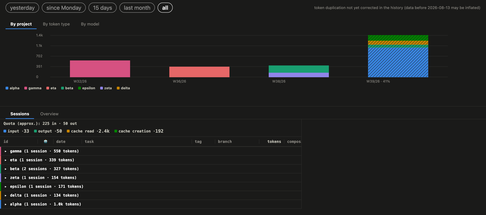
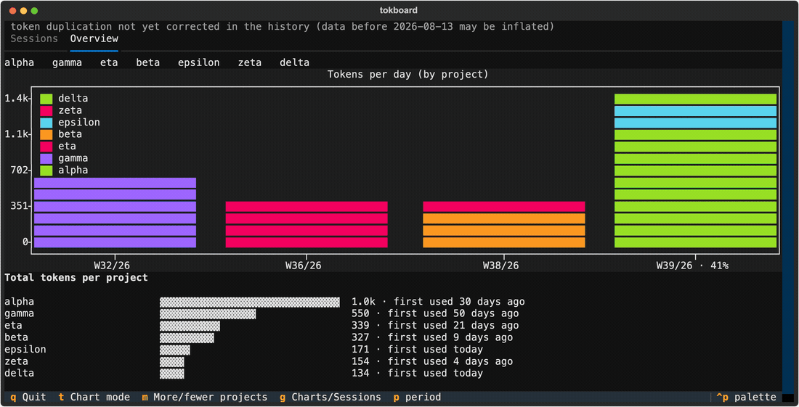
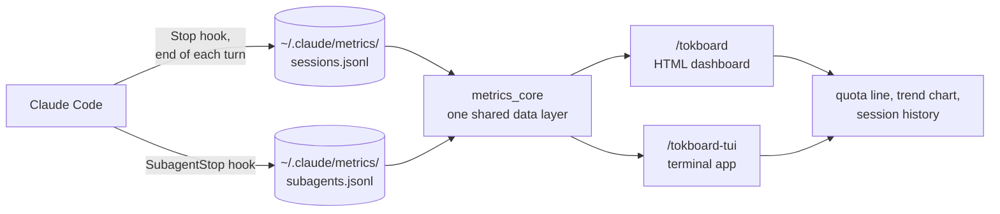

🇺🇸 [English](README.md) · 🇧🇷 [Português](README.pt.md)

[](https://github.com/albertosca/claude-tokboard/actions/workflows/ci.yml)
[](https://github.com/albertosca/claude-tokboard/actions/workflows/lint.yml)
[](https://github.com/albertosca/claude-tokboard/blob/main/.github/badges/coverage.svg)

# tokboard

**See where your Claude Code tokens go** - by day, by project, by token type and by model.

A raw token count mixes cheap cache reads with the tokens that count against rate limits. tokboard logs every Claude Code session and subagent in the background and shows you both numbers - in your browser or in your terminal, without anything leaving your machine.



<sub>The HTML dashboard. All screenshots are rendered from the repo's synthetic test data - no real sessions.</sub>

## What you get

- **A quota view, not just a volume view.** A separate line estimates how much of your rate limit a period used: input and cache writes on one side, output on the other, cache reads left out - the weighting Anthropic documents for its API. Claude Code doesn't publish its own formula, so the line is labelled approximate.
- **One day, three slicings.** The trend chart splits each day's total by project, by token type or by model. A day stays the same height in every tab, so switching re-slices it instead of rescaling it.
- **An honest last bar.** The browser always shows how much of the bucket still in progress has elapsed, hatched, so a half-finished week never reads as a drop there; the terminal app shows the same percentage in its last tick label when there's room, but drops it at narrow terminal widths for lack of space.
- **Every session, with its subagents.** Sessions are grouped by project, each with its subagents, duration and token breakdown, and filterable by period.
- **Click to highlight.** Click a legend entry or a bar to spotlight one project, token type or model across the chart.



<sub>The terminal app - same data, keyboard-driven: <kbd>g</kbd> charts/sessions, <kbd>t</kbd> chart mode, <kbd>p</kbd> period, <kbd>q</kbd> quit.</sub>

> The interface speaks English and Brazilian Portuguese, following your terminal's locale - or set "language": "en" or "pt" (or a tag like pt-BR) in ~/.claude/metrics/config.json. The token types - input, output, cache read, cache creation - keep their English names in both languages, because those are the terms Anthropic's API uses for them.

## Install

From a shell:

```bash
claude plugin marketplace add albertosca/claude-tokboard
claude plugin install tokboard@tokboard
```

Inside Claude Code, `/plugin` does the same interactively (more in the [Claude Code plugin docs](https://docs.claude.com/en/docs/claude-code)). Logging starts on its own; then, whenever you want to look:

| Command | What it does |
|---|---|
| `/tokboard` | Builds the HTML dashboard and opens it in your browser. Standard-library Python only - nothing to install. |
| `/tokboard-tui` | Opens the terminal app. The first run creates a virtual environment in the plugin's own folder (`.venv`) and installs `textual` and `textual-plotext` into it from PyPI. Every run then prints the command to paste into your own terminal. |

The browser opens by itself on macOS; elsewhere, open `~/.claude/metrics/dashboard.html`.

The command `/tokboard-tui` prints looks like this, with the plugin's real folder filled in:

```bash
<plugin folder>/.venv/bin/python3 <plugin folder>/dashboard_tui.py
```

The terminal app needs `python3` 3.10 or newer, with the `venv` module.

<details>
<summary><code>/tokboard-tui</code> fails on first run with an <code>ensurepip</code> error (Debian/Ubuntu)</summary>

The auto-install needs the `python3-venv` package, which isn't always preinstalled. Run `sudo apt install python3-venv` (or the version-specific `python3.X-venv` the error names) and try again. `/tokboard` is unaffected either way.
</details>

## How it works



Two hooks append a line to a local log after every turn and every subagent. Both dashboards read those logs through the same library, so a number means the same thing in either one.

## Optional settings

**AI task labels.** Claude can label each session with a short summary ("fixing auth redirect bug"). It's off by default, because each new label is a `claude -p` call on your own quota.

Turn it on with `--label-budget N` (N new labels per run; cached ones are free), via `/tokboard-tui --label-budget N` or by running a dashboard script directly.

**Filters.** Both scripts also take `--project`, `--tag` and `--days`/`--all` to narrow what they show.

**Naming your projects.** A session is logged under the directory it ran in, which isn't always the project. List the folders your projects live in, in `~/.claude/metrics/config.json`:

```json
{ "project_roots": ["~/code", "~/work"] }
```

| Session ran in | Shown without `project_roots` | Shown with `~/code` listed |
|---|---|---|
| `~/code/my-api/docs/vendor` | vendor | my-api |

Every folder directly inside a listed root is one project, however deep the session went. Sessions logged by recent versions already record their project root, so this mostly fixes older history.

**tmux.** If you run Claude Code inside tmux, the hook records the tmux window's name with each session, and the HTML dashboard shows it. Nothing to configure.

## Your data

- Everything lives in `~/.claude/metrics/`: the session and subagent logs, label caches and the rendered dashboard.
- Nothing leaves your machine - unless you turn on AI labels, which send each labelled session to Claude to be summarized.
- Uninstalling stops new logging and keeps what's already there.

## How it's built

- **One data layer, two interfaces.** Both dashboards read from `lib/metrics_core/`, pure standard-library Python - every number is computed once and tested once.
- **100% statement and branch coverage, enforced.** A single uncovered line fails CI.
- **The page is tested by using it.** The rendering tests drive the real generated dashboard in jsdom - clicking, filtering, highlighting - and assert on computed styles, not on markup.
- **Strict static checks.** `ruff` with ten rule families and `mypy --strict` on every push to main and every pull request.
- **Careful with your data.** The scripts that repair old logs are dry runs unless given `--apply`, back up the file and verify the copy by sha256 before writing, and the per-model one first checks its reconstruction against records the hook had logged natively, refusing to run on a disagreement.

## Upgrading

```bash
claude plugin marketplace update tokboard
claude plugin update tokboard@tokboard
```

Restart Claude Code afterwards to load the new version.

Since 2.1.0, AI task labels are cached per language. The first time 2.1.0 or later saves to `~/.claude/metrics/task_labels.json` or `agent_labels.json`, it converts the file to the new format and keeps the original next to it as `task_labels.json.pre-i18n` or `agent_labels.json.pre-i18n`. To go back to a version before 2.1.0, copy those files back over the new ones: that restores your AI task labels in the format the older version reads.

From 2.2.0, the tools count is per distinct tool call - about 4x higher than before on the same work - while older rows keep their old counts as logged. Also from 2.2.0: subagent output recorded on Claude Code 2.1.278 or later is a lower bound, since Claude Code doesn't always write a subagent message's final usage.

## Contributing

```bash
pip install -r requirements-dev.txt -r requirements-tui.txt
npm install                     # jsdom, for the rendering tests
pytest                          # full suite - 100% coverage is a hard gate
ruff check . && ruff format --check .
mypy --strict .
```

No build step. `dashboard_html.py` and `dashboard_tui.py` are the two entry points. PRs are welcome - for anything beyond a small fix, open an issue first so we can agree on the direction.

## License

[MIT](LICENSE)
