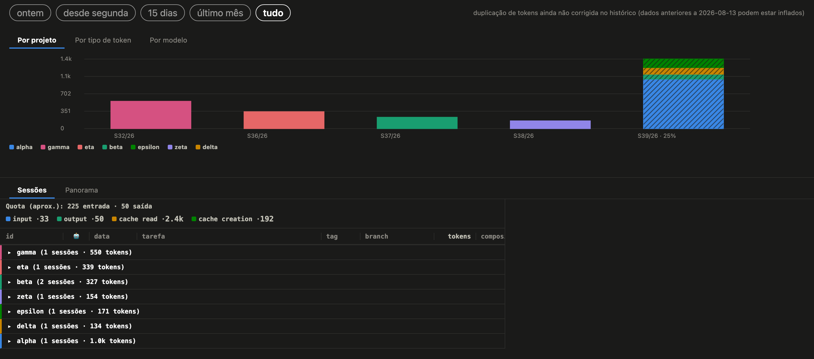
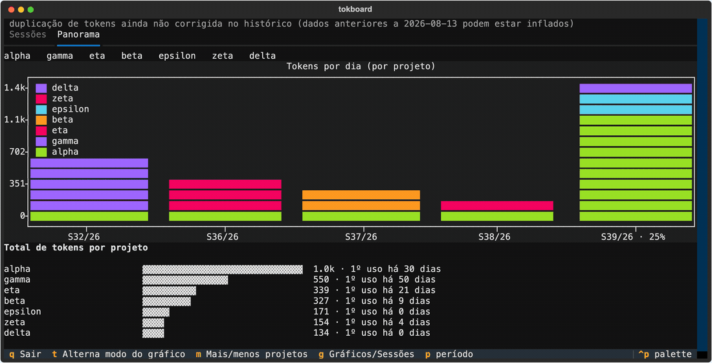

🇺🇸 [English](README.md) · 🇧🇷 [Português](README.pt.md)

[](https://github.com/albertosca/claude-tokboard/actions/workflows/ci.yml)
[](https://github.com/albertosca/claude-tokboard/actions/workflows/lint.yml)
[](https://github.com/albertosca/claude-tokboard/blob/main/.github/badges/coverage.svg)

# tokboard

**Veja para onde vão os seus tokens do Claude Code** - por dia, por projeto, por tipo de token e por modelo.

Um plugin do Claude Code que registra cada sessão e cada subagente em segundo plano e mostra tudo de volta de dois jeitos: um dashboard HTML no navegador e um app completo de terminal.



<sub>O dashboard HTML. Todas as imagens são geradas a partir dos dados sintéticos de teste do próprio repositório - nenhuma sessão real.</sub>

## O que você ganha

- **Um dia, três recortes.** O gráfico de tendência divide o total de cada dia por projeto, por tipo de token ou por modelo. Um dia tem a mesma altura em todas as abas, então trocar de aba refatia o dia em vez de mudar a escala.
- **Uma visão de cota, não só de volume.** A maior parte dos tokens é leitura de cache, que é barata. Uma linha à parte estima quanto da sua cota de rate limit o período consumiu, pela regra documentada da Anthropic.
- **Uma última barra honesta.** O período que ainda está em andamento mostra quanto dele já passou (e aparece hachurado, no navegador), para que uma semana pela metade nunca pareça uma queda.
- **Histórico de sessões.** Cada sessão agrupada por projeto, com seus subagentes, duração e tokens detalhados - filtrável por período.
- **Clique para destacar.** Clique numa entrada da legenda ou numa barra para destacar um projeto, tipo de token ou modelo no gráfico inteiro.



<sub>O app de terminal - os mesmos dados, pelo teclado: <kbd>g</kbd> gráficos/sessões, <kbd>t</kbd> modo do gráfico, <kbd>p</kbd> período, <kbd>q</kbd> sair.</sub>

> A interface é em português.

## Instalação

Instale pelo sistema de plugins do Claude Code (veja a [documentação de plugins do Claude Code](https://docs.claude.com/en/docs/claude-code)). Depois:

| Comando | O que faz |
|---|---|
| `/tokboard` | Gera o dashboard HTML e abre no navegador. Sem dependências. |
| `/tokboard-tui` | Prepara o app de terminal na primeira vez e te entrega o comando para abri-lo no seu próprio terminal. |

O navegador abre sozinho no macOS; nos outros sistemas, abra `~/.claude/metrics/dashboard.html`.

<details>
<summary><code>/tokboard-tui</code> falha na primeira vez com um erro de <code>ensurepip</code> (Debian/Ubuntu)</summary>

A instalação automática precisa do pacote `python3-venv`, que nem sempre vem instalado. Rode `sudo apt install python3-venv` (ou o `python3.X-venv` específico que o erro indicar) e tente de novo. O `/tokboard` não é afetado.
</details>

## Configurações opcionais

**Rótulos de tarefa por IA.** O Claude pode rotular cada sessão com um resumo curto ("corrigindo bug no redirect de login"). Vem desligado, porque cada rótulo novo é uma chamada `claude -p` na sua própria cota.

Para ligar, use `--label-budget N` (N rótulos novos por execução; os que já estão em cache são grátis), via `/tokboard-tui --label-budget N` ou rodando um dos scripts do dashboard diretamente.

**Filtros.** Os dois scripts também aceitam `--project`, `--tag` e `--days`/`--all` para restringir o que mostram.

**Nomeando seus projetos.** Uma sessão é registrada com o diretório onde rodou, então um trabalho dentro de `minha-api/docs/vendor` apareceria como "vendor". Diga ao tokboard onde seus projetos ficam, em `~/.claude/metrics/config.json`:

```json
{ "project_roots": ["~/code", "~/work"] }
```

Toda pasta diretamente dentro de uma raiz listada é um projeto, por mais fundo que a sessão tenha ido. Sessões novas já gravam a raiz do projeto sozinhas; essa configuração é o que dá nome às antigas.

**tmux.** Se você roda o Claude Code dentro do tmux, cada sessão mostra a janela onde rodou. Nada para configurar.

## Como é feito

- **Uma camada de dados, duas interfaces.** Os dois dashboards leem de `lib/metrics_core/`, em Python só com a biblioteca padrão - cada número é calculado uma vez e testado uma vez.
- **100% de cobertura de linhas e de ramos, obrigatória.** Uma única linha sem teste reprova o CI.
- **A página é testada sendo usada.** Os testes de renderização dirigem o dashboard real gerado dentro do jsdom - clicando, filtrando, destacando - e verificam os estilos computados, não o markup.
- **Checagem estática rigorosa.** `ruff` com dez famílias de regras e `mypy --strict` a cada push.
- **Cuidado com os seus dados.** Migrações sobre os seus logs, que não têm substituto, rodam primeiro a seco, são conferidas contra um oráculo independente e só escrevem depois de um backup verificado.

## Seus dados

- Tudo fica em `~/.claude/metrics/`: os logs de sessões e subagentes, o cache de rótulos e o dashboard gerado.
- Nada sai da sua máquina - a não ser que você ligue os rótulos por IA, que mandam cada sessão rotulada para o Claude resumir.
- Desinstalar para o registro de sessões novas e mantém o que já está lá.

## Contribuindo

```bash
pip install -r requirements-dev.txt -r requirements-tui.txt
npm install                     # jsdom, para os testes de renderização
pytest                          # suíte completa - 100% de cobertura é obrigatório
ruff check . && ruff format --check .
mypy --strict .
```

Não há etapa de build. `dashboard_html.py` e `dashboard_tui.py` são os dois pontos de entrada. PRs são bem-vindos - para qualquer coisa além de uma correção pequena, abra uma issue antes para combinarmos a direção.

## Licença

[MIT](LICENSE)
