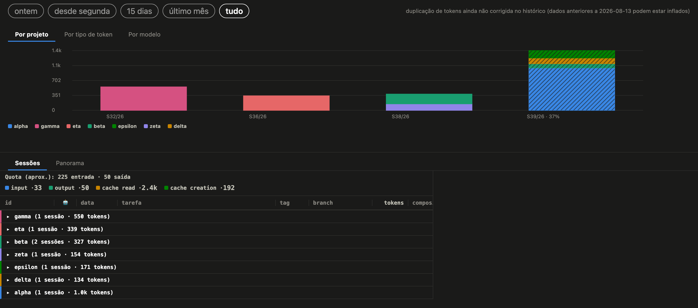
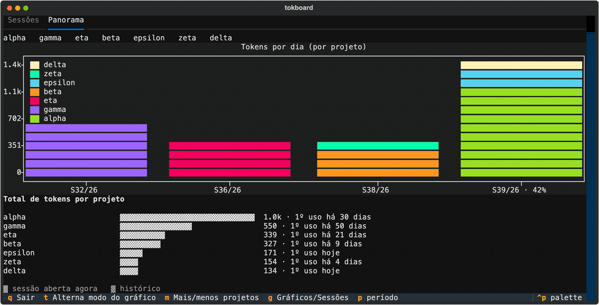
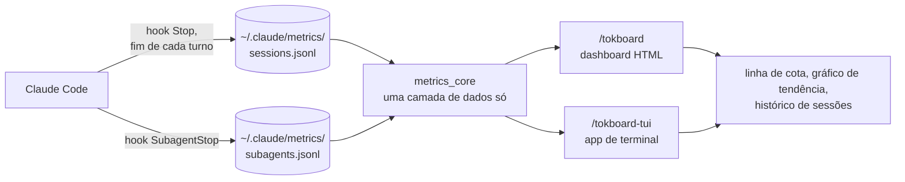

🇺🇸 [English](README.md) · 🇧🇷 [Português](README.pt.md)

[](https://github.com/albertosca/claude-tokboard/actions/workflows/ci.yml)
[](https://github.com/albertosca/claude-tokboard/actions/workflows/lint.yml)
[](https://github.com/albertosca/claude-tokboard/blob/main/.github/badges/coverage.svg)

# tokboard

**Veja para onde vão os seus tokens do Claude Code** - por dia, por projeto, por tipo de token e por modelo.

Uma contagem crua de tokens mistura leitura de cache, que é barata, com os tokens que contam para o rate limit. O tokboard registra cada sessão e cada subagente do Claude Code em segundo plano e mostra os dois números - no navegador ou no terminal, sem nada sair da sua máquina.



<sub>O dashboard HTML. Todas as imagens são geradas a partir dos dados sintéticos de teste do próprio repositório - nenhuma sessão real.</sub>

## O que você ganha

- **Uma visão de cota, não só de volume.** Uma linha à parte estima quanto do seu rate limit o período consumiu: entrada e escrita de cache de um lado, saída do outro, leitura de cache fora da conta - o peso que a Anthropic documenta para a API dela. O Claude Code não publica a própria fórmula, então a linha vem marcada como aproximada.
- **Um dia, três recortes.** O gráfico de tendência divide o total de cada dia por projeto, por tipo de token ou por modelo. Um dia tem a mesma altura em todas as abas, então trocar de aba refatia o dia em vez de mudar a escala.
- **Uma última barra honesta.** O período que ainda está em andamento mostra quanto dele já passou (e aparece hachurado, no navegador), para que uma semana pela metade nunca pareça uma queda.
- **Cada sessão, com os seus subagentes.** As sessões ficam agrupadas por projeto, cada uma com seus subagentes, duração e tokens detalhados, e dá para filtrar por período.
- **Clique para destacar.** Clique numa entrada da legenda ou numa barra para destacar um projeto, tipo de token ou modelo no gráfico inteiro.



<sub>O app de terminal - os mesmos dados, pelo teclado: <kbd>g</kbd> gráficos/sessões, <kbd>t</kbd> modo do gráfico, <kbd>p</kbd> período, <kbd>q</kbd> sair.</sub>

> A interface fala inglês e português do Brasil, seguindo o locale do seu terminal - ou defina "language": "en" ou "pt" (ou uma tag como pt-BR) em ~/.claude/metrics/config.json. Os tipos de token - input, output, cache read, cache creation - ficam em inglês nos dois idiomas, porque são os nomes que a própria API da Anthropic usa.

## Instalação

No terminal:

```bash
claude plugin marketplace add albertosca/claude-tokboard
claude plugin install tokboard@tokboard
```

Dentro do Claude Code, o `/plugin` faz o mesmo de forma interativa (mais detalhes na [documentação de plugins do Claude Code](https://docs.claude.com/en/docs/claude-code)). O registro começa sozinho; depois, sempre que quiser olhar:

| Comando | O que faz |
|---|---|
| `/tokboard` | Gera o dashboard HTML e abre no navegador. Só usa a biblioteca padrão do Python - não há nada para instalar. |
| `/tokboard-tui` | Abre o app de terminal. Na primeira vez, cria um ambiente virtual na própria pasta do plugin (`.venv`) e instala nele o `textual` e o `textual-plotext`, baixados do PyPI. A cada uso, imprime o comando para você colar no seu terminal. |

O navegador abre sozinho no macOS; nos outros sistemas, abra `~/.claude/metrics/dashboard.html`.

O comando que o `/tokboard-tui` imprime tem esta cara, já com a pasta real do plugin:

```bash
<pasta do plugin>/.venv/bin/python3 <pasta do plugin>/dashboard_tui.py
```

O app de terminal precisa de `python3` 3.10 ou mais novo, com o módulo `venv`.

<details>
<summary><code>/tokboard-tui</code> falha na primeira vez com um erro de <code>ensurepip</code> (Debian/Ubuntu)</summary>

A instalação automática precisa do pacote `python3-venv`, que nem sempre vem instalado. Rode `sudo apt install python3-venv` (ou o `python3.X-venv` específico que o erro indicar) e tente de novo. O `/tokboard` não é afetado.
</details>

## Como funciona



Dois hooks acrescentam uma linha a um log local ao fim de cada turno e de cada subagente. Os dois dashboards leem esses logs pela mesma biblioteca, então um número quer dizer a mesma coisa em qualquer um deles.

## Configurações opcionais

**Rótulos de tarefa por IA.** O Claude pode rotular cada sessão com um resumo curto ("corrigindo bug no redirect de login"). Vem desligado, porque cada rótulo novo é uma chamada `claude -p` na sua própria cota.

Para ligar, use `--label-budget N` (N rótulos novos por execução; os que já estão em cache são grátis), via `/tokboard-tui --label-budget N` ou rodando um dos scripts do dashboard diretamente.

**Filtros.** Os dois scripts também aceitam `--project`, `--tag` e `--days`/`--all` para restringir o que mostram.

**Nomeando seus projetos.** Uma sessão é registrada com o diretório onde rodou, que nem sempre é o projeto. Liste as pastas onde seus projetos ficam, em `~/.claude/metrics/config.json`:

```json
{ "project_roots": ["~/code", "~/work"] }
```

| Sessão rodou em | Aparece sem `project_roots` | Aparece com `~/code` na lista |
|---|---|---|
| `~/code/minha-api/docs/vendor` | vendor | minha-api |

Toda pasta diretamente dentro de uma raiz listada é um projeto, por mais fundo que a sessão tenha ido. Sessões registradas por versões recentes já gravam a raiz do projeto, então isso serve principalmente para o histórico antigo.

**tmux.** Se você roda o Claude Code dentro do tmux, o hook grava o nome da janela do tmux junto com cada sessão, e o dashboard HTML mostra esse nome. Nada para configurar.

## Seus dados

- Tudo fica em `~/.claude/metrics/`: os logs de sessões e subagentes, o cache de rótulos e o dashboard gerado.
- Nada sai da sua máquina - a não ser que você ligue os rótulos por IA, que mandam cada sessão rotulada para o Claude resumir.
- Desinstalar para o registro de sessões novas e mantém o que já está lá.

## Como é feito

- **Uma camada de dados, duas interfaces.** Os dois dashboards leem de `lib/metrics_core/`, em Python só com a biblioteca padrão - cada número é calculado uma vez e testado uma vez.
- **100% de cobertura de linhas e de ramos, obrigatória.** Uma única linha sem teste reprova o CI.
- **A página é testada sendo usada.** Os testes de renderização dirigem o dashboard real gerado dentro do jsdom - clicando, filtrando, destacando - e verificam os estilos computados, não o markup.
- **Checagem estática rigorosa.** `ruff` com dez famílias de regras e `mypy --strict` a cada push na main e em todo pull request.
- **Cuidado com os seus dados.** Os scripts que corrigem logs antigos só simulam, a menos que recebam `--apply`; antes de escrever, fazem backup do arquivo e conferem a cópia por sha256. O de tokens por modelo ainda confronta a reconstrução com os registros que o hook gravou nativamente, e se recusa a rodar se houver divergência.

## Atualizando

```bash
claude plugin marketplace update tokboard
claude plugin update tokboard@tokboard
```

Depois, reinicie o Claude Code para carregar a versão nova.

A partir da 2.1.0, os rótulos de tarefa de IA ficam em cache por idioma. Na primeira vez que a 2.1.0 ou mais nova grava em `~/.claude/metrics/task_labels.json` ou `agent_labels.json`, ela converte o arquivo para o formato novo e guarda o original ao lado, como `task_labels.json.pre-i18n` ou `agent_labels.json.pre-i18n`. Para voltar a uma versão anterior à 2.1.0, copie esses arquivos por cima dos novos: isso restaura seus rótulos de tarefa de IA no formato que a versão antiga lê.

A partir da 2.2.0, a contagem de ferramentas passa a ser por chamada distinta - cerca de 4x maior que antes para o mesmo trabalho -, enquanto as linhas antigas mantêm a contagem de quando foram gravadas; também a partir da 2.2.0, o consumo de subagente registrado pelo Claude Code 2.1.278 ou mais recente é um piso, porque o Claude Code nem sempre grava o consumo final de uma mensagem de subagente.

## Contribuindo

```bash
pip install -r requirements-dev.txt -r requirements-tui.txt
npm install                     # jsdom, para os testes de renderização
pytest                          # suíte completa - 100% de cobertura é obrigatório
ruff check . && ruff format --check .
mypy --strict .
```

Não há etapa de build. `dashboard_html.py` e `dashboard_tui.py` são os dois pontos de entrada. PRs são bem-vindos - para qualquer coisa além de uma correção pequena, abra uma issue antes para combinarmos a direção.

## Licença

[MIT](LICENSE)
